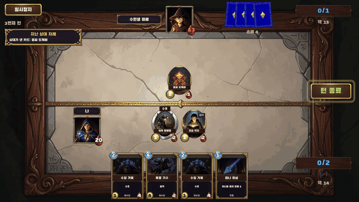

# open-game-works-core-impl

[English](README.md)

open-game-works의 코어다. 하네스로 만드는 모든 게임의 바탕이 되는 Godot 클라이언트 코어, TypeScript 서버 코어,
기본 protobuf, contract tool과 data tool을 담는다.

https://github.com/user-attachments/assets/fb74b4ca-cc63-430d-af79-5b5118ec9c8a

https://github.com/user-attachments/assets/9cf4f284-32c5-4f82-9c3f-13d17cbc12ec

<table>
  <tr>
    <td align="center" width="50%"><br><a href="https://github.com/wnsrn3436/open-game-works-game-iso-survivors">iso-survivors</a>: 아이소메트릭 3D 호드 서바이벌</td>
    <td align="center" width="50%"><br><a href="https://github.com/wnsrn3436/open-game-works-game-mana-clash">mana-clash</a>: 1대1 카드 배틀</td>
  </tr>
  <tr>
    <td align="center" width="50%"><br><a href="https://github.com/wnsrn3436/open-game-works-game-pong">pong</a>: CPU와 대결하는 패들 게임</td>
    <td align="center" width="50%"><br>card-duel: AI와 겨루는 실시간 카드 배틀. open-game-works의 아주 초기 버전으로 만들었다 (저장소 비공개)</td>
  </tr>
</table>

## 소개

[open-game-works](https://github.com/wnsrn3436/open-game-works-core)는 AI 에이전트가 서버-클라이언트 게임을 만드는
하네스다. 여러 게임이 매번 같은 방식으로 다시 작성하게 되는 기능은 **코어**(core)로 미리 한 번 만들어 둔다.
에이전트는 그 위에서 게임플레이만 **콘텐츠 코드**(content code)로 작성한다. 코어에는 게임플레이 루프 밖의 기능만
들어간다.

| 영역 | 예 |
|---|---|
| 인프라 | 서버 요청 처리와 저장, 로그인, 네트워크와 실시간 연결, 업데이트, 클라이언트 UI, 입력, 연출 도구, 플랫폼 연동, 개발·테스트 도구 |
| 라이브 운영 | 점검, 공지, 킬 스위치, 아이템 지급과 회수, 제재, 쿠폰, 라이브 이벤트, 원격 설정, 푸시, 번들 패치 |
| 스토어 정책 | 영수증 검증과 환불 처리, 약관 동의, 연령 확인, 계정 삭제, 확률 공개, 스토어 개인정보 공개, 추적 권한 |
| 메타 시스템 | 아이템, 상점, 우편함, 미션, 출석, 가챠, 랭킹, 레이팅, 친구, 길드 |

이 저장소는 그 코어의 구현이다. 에이전트가 하네스를 통해 개발하고, 이 저장소의 GitHub Releases로 릴리스한다. 각
게임은 자기 `settings.json`의 `coreVersion`으로 릴리스 하나를 고정해서 쓴다.

| 저장소 | 내용 |
|---|---|
| [open-game-works-core](https://github.com/wnsrn3436/open-game-works-core) | 하네스: 에이전트 규칙, 스킬, 모듈 스펙, CLI `ogw` |
| [open-game-works-core-impl](https://github.com/wnsrn3436/open-game-works-core-impl) | 이 저장소: 코어 구현. 코어 릴리스는 이 저장소의 GitHub Releases |
| [open-game-works-game-mana-clash](https://github.com/wnsrn3436/open-game-works-game-mana-clash) | open-game-works로 만든 게임 |
| [open-game-works-game-pong](https://github.com/wnsrn3436/open-game-works-game-pong) | open-game-works로 만든 게임 |
| [open-game-works-game-iso-survivors](https://github.com/wnsrn3436/open-game-works-game-iso-survivors) | open-game-works로 만든 게임 |

## 현재 상태

open-game-works는 아직 한창 개발 중이고, 이 코어도 마찬가지다. 코어 작업은 지금까지 macOS에서
Claude Opus 5.5(high effort)를 쓰는 Claude Code로만 테스트했고, `build` 명령은 아직 실행해 보지 않았다. 자세한 내용은
[하네스 README](https://github.com/wnsrn3436/open-game-works-core/blob/main/README.ko.md#현재-상태)에 있다.

## 동작 방식

```
open-game-works-core (하네스)
  skills/client-core/modules/*.md       클라이언트 모듈 스펙
  skills/server-core/modules/*.md       서버 모듈 스펙
        |
        |  ogw core spec                  -> core-spec/<module>.json
        |  코어 에이전트가 구현           -> client/godot/, server/core/, tools/
        |  ogw core test, ogw code check core, 리뷰 에이전트
        v
open-game-works-core-impl (이 저장소, main 브랜치)
        |
        |  ogw core release <version>     -> v<version> 태그, 애셋을 담은 GitHub Release
        v
open-game-works-core-releases/<version>/  받아 온 릴리스의 로컬 캐시, SHA-256으로 확인
        |
        |  ogw generate
        v
games/<game>/                             settings.json "coreVersion": "<version>"
  client/core/                            <- client-godot.zip의 core/
  server/core/                            <- server.tgz
```

- **스펙이 먼저다.** 모든 모듈은 하네스에 스펙이 있고, 스펙은 엔진과 무관하게 공개 API, 동작, 훅, 이벤트, 오류,
  설정, 데이터, 테스트를 적는다. 구현은 스펙이 바뀐 뒤에만 바뀐다. `core-spec/`은 그 스펙 중 도구가 읽는 부분이다.
  `ogw core spec`이 쓰고, 사람이 직접 고치지 않는다.
- **코어는 콘텐츠 코드에 의존하지 않는다.** 콘텐츠 코드는 훅, 콜백, 데이터만 코어에 넘긴다. 게임마다 다른 판단은
  훅(검증 훅, 처리 훅, 사후 훅)이 맡고, 코어가 콘텐츠 코드에 알릴 일은 이벤트로 전한다.
- **버전은 하나다.** 클라이언트 코어, 서버 코어, contract tool, data tool, 코어 설정이 하나의 코어 버전을 함께 쓴다.
- **코어 설정.** 기본값은 `settings/core-settings.json`에 있고, 키 형식은 `<module name>.<camelCase>`다(예:
  `NetworkCore.retryCount`). 게임은 게임 설정의 `core` 객체에서 이 값을 덮어쓴다.
- **게임이 쓰는 모듈.** `BootstrapCore`, `routing`, `migration`, `user-snapshot-clone`, 게임 설정 `coreModules`에 적힌
  모듈, 그리고 이 모듈들이 의존하는 모든 모듈.
- **게임은 코어를 고치지 않는다.** 게임의 `client/core/`와 `server/core/`는 코어 릴리스의 사본이고, 정적 검사
  `core diff`가 릴리스와 비교한다. 코어가 부족하면 콘텐츠 에이전트가 게임의 `records/core-proposals/`에 코어 제안을
  쓰고, 사람이 `update core`로 적용을 지시한다.

## 저장소 구성

| 경로 | 내용 |
|---|---|
| `client/godot/` | Godot 클라이언트 코어. 폴더 자체가 Godot 프로젝트다. `core/<module folder>/`에 모듈이 하나씩 있고, `engine.json`이 엔진, 테스트 도구, 플러그인, 플랫폼별 빌드 도구를 고정한다 |
| `client/godot/plugins/ogw-native-ui/` | 네이티브 플러그인 `ogw-native-ui`(Android, iOS, macOS)의 소스, 미리 빌드한 `dist/`, `build.sh` |
| `server/core/` | TypeScript 서버 코어. 모듈마다 폴더 하나와, 서버 프로세스 진입점 `start.ts` |
| `server/generated/`, `server/dev/generated/` | 코어 테스트 데이터로 생성한 코드. 서버 코어 테스트가 쓴다 |
| `proto/ogw/` | 기본 protobuf: `core.proto`, `options.proto` |
| `tools/contract-tool/` | contract tool (npm 패키지) |
| `tools/data-tool/` | data tool (npm 패키지) |
| `tools/tests/` | 두 도구의 왕복(round-trip) 테스트 입력: `game/`(게임 저장소 구조의 contract, 데이터, 게임 설정), `godot/`(Godot 왕복 테스트) |
| `core-spec/` | 모듈마다 JSON 파일 하나. `ogw core spec`이 하네스의 모듈 스펙에서 생성하며, 사람이 고치지 않는다 |
| `settings/` | `core-settings.json`(코어 설정 기본값)과 `core-settings.schema.json`(그 JSON 스키마) |
| `fixtures/` | 코어 테스트 픽스처: 클라이언트 코어 테스트와 서버 코어 테스트가 함께 읽는 입력·기댓값 파일 |
| `test-data/` | 게임 저장소 구조로 된 코어 테스트 데이터: `contract/`, `data/`, `settings.json`, `records/setup/banned-words/`의 금칙어 목록 |
| `benchmark/godot/` | 게임 저장소 구조로 된 벤치마크 게임. 릴리스 애셋 `benchmark-godot.zip`으로 배포한다 |
| `licenses.json` | 클라이언트에 들어가는 서드파티 구성 요소의 라이선스 목록 |

`core-spec/`, `client/godot/project.godot`, `benchmark/` 밖의 각 `generated/` 폴더는 `ogw core spec`과
`ogw core test`(코어 테스트 데이터로 contract tool과 data tool을 실행)가 쓰고, 하네스 도구가 커밋한다.

### 클라이언트 코어 (Godot)

- 엔진은 `client/godot/engine.json`에 고정되어 있다: Godot `4.7.2.stable`, 테스트용 GUT `9.7.1`, 네이티브 플러그인,
  플랫폼별 빌드 도구(Android는 JDK 17과 Android command-line tools, iOS와 macOS는 Xcode, Windows는 Jsign과
  Temurin JRE).
- 코어 모듈 코드는 GDScript만 쓴다. 네이티브 코드는 `engine.json` `plugins`의 플러그인으로만 들어온다.
- 모듈은 `core/<module folder>/<module folder>.gd`에 `class_name <Module>`로 선언한 정적 클래스이고, 폴더 이름은
  모듈 이름의 snake_case다(`UICore` -> `core/ui_core/`). 모듈 폴더에는 `adapters/`(외부 서비스 어댑터),
  `dev/`(DEV 코드, STG·PROD 빌드에서 빠짐), `tests/`(코어 테스트, 릴리스에 포함되지 않음)가 있을 수 있다.
- `core/web/`에는 Web export용 HTML 셸과 서비스 워커가 있다.
- 코어 테스트는 `UnitTestCore`를 통해 GUT로 돌린다. 네이티브 실행과, Web export를 띄운 헤드리스 브라우저 실행 두
  가지가 있다.
- `engine.json` `plugins`의 네이티브 플러그인: `webrtc-native`(Godot WebRTC GDExtension, `RealtimeCore`가 사용)와,
  코어가 직접 작성하는 `ogw-native-ui`.

`ogw-native-ui`는 `NativeUiCore`에 스토어 리뷰 요청 창과 공유 창을 제공한다. 지원 플랫폼은 Android(Godot Android
plugin v2, Gradle), iOS(xcframework에 담은 정적 라이브러리, Xcode 프로젝트), macOS(GDExtension, SCons)다. 빌드
결과는 `dist/<platform>/`에 커밋되어 있다. Mac 호스트에서 `build.sh <work folder>`로 다시 빌드한다. 작업 폴더에
Godot 소스와 godot-cpp를 한 번 받아 두며, Xcode, SCons, JDK 17(`JAVA_HOME`), Android SDK(`ANDROID_HOME`)가
필요하다. `ogw core release`는 `dist/`를 릴리스 애셋 `client-godot-plugins.zip`으로 묶고, 그 URL과 SHA-256을
`engine.json`에 쓴다.

### 서버 코어 (TypeScript)

- 모듈 폴더 `server/core/<module>/`에는 `index.ts`(진입 파일), `adapters/`(real·sandbox·clock 어댑터),
  `dev/`(fake 어댑터를 포함한 DEV 코드), `tests/`(`<topic>.test.ts`)가 있다. `cheat`과 `testing`은 모듈 전체가
  DEV 코드다.
- DB는 어댑터 뒤에 있다. 로컬은 SQLite, DEV·STG·PROD는 PostgreSQL을 쓴다. 서버 코어 테스트는 vitest로 SQLite와
  PostgreSQL 양쪽에서 돌린다.
- 외부 서비스(예: 스토어 결제, 광고, 푸시, 소셜 로그인)는 어댑터 뒤에 있으며, 인터페이스마다 fake, sandbox, real
  어댑터가 있다.
- 실시간은 P2P로 시작한다(`matchmaker`, `p2p-signaling`). 실시간 메시지 contract와 전송 계층은 분리되어 있다.
- 사용자 아이템은 `item-ledger` API로만 바뀐다.
- 릴리스의 `server.tgz`는 `server/core/`에서 `tests/` 폴더를 뺀 것이다.

### 기본 protobuf와 도구

- `proto/ogw/core.proto`(package `ogw.core`)에는 응답 봉투 `ResponseEnvelope`, `ServerError`와 `CoreError`,
  UserState delta, `service Core`(코어 rpc), `service CoreCheat`(코어 치트), 코어 모듈의 메시지가 있다.
- `proto/ogw/options.proto`(package `ogw`)에는 게임 contract가 쓰는 커스텀 옵션이 있다: 요청 옵션(`silent`,
  `retry`, `errors`, `sensitive`), `core_errors`, `public`, `converters`, 필드 검증 규칙 `v`.
- **contract tool**은 게임 contract를 작성 규칙과 하위 호환성에 비추어 검사한 뒤, 그로부터 클라이언트 코드와 서버
  코드(그리고 각각의 DEV 코드)를 생성한다.
- **data tool**은 게임 데이터 CSV 테이블을 읽고 검사해 data proto, 생성 코드, 바이너리로 빌드하며, 게임의 ID
  레지스트리를 통해 ID 값을 발급한다.
- 두 도구는 각각 npm 패키지 하나다. `npm run build`가 `bin/<tool>.js` 하나로 번들하고(커밋하지 않음), 테스트는
  `tests/` 아래의 `*.test.ts`이며 vitest로 돌린다. 릴리스에는 `contract-tool.tgz`와 `data-tool.tgz`로 들어가고,
  각각 `proto/` 아래에 기본 protobuf를 함께 담는다.

## 모듈

클라이언트 모듈 43개, 서버 모듈 42개가 있고, 모듈마다 하네스에 스펙이 있다:
[클라이언트 모듈 목록](https://github.com/wnsrn3436/open-game-works-core/blob/main/skills/client-core/SKILL.md)과
[스펙](https://github.com/wnsrn3436/open-game-works-core/tree/main/skills/client-core/modules),
[서버 모듈 목록](https://github.com/wnsrn3436/open-game-works-core/blob/main/skills/server-core/SKILL.md)과
[스펙](https://github.com/wnsrn3436/open-game-works-core/tree/main/skills/server-core/modules).

클라이언트 모듈 (`client/godot/core/`):

| 용도 | 모듈 |
|---|---|
| 기반 | `UtilCore`, `LogCore`, `EventCore`, `TimeCore`, `LocalDataCore`, `BootstrapCore` |
| 리소스, 데이터, 사운드 | `ResourceCore`, `PoolCore`, `DataCore`, `RequirementCore`, `LocalizationCore`, `SoundCore` |
| 서버, 계정, 상태 | `NetworkCore`, `UserStateCore`, `AuthCore`, `GameUpdateCore`, `RemoteConfigCore`, `NoticeCore` |
| 스토어, 광고, 푸시 | `PaymentCore`, `AdCore`, `PushCore` |
| 화면, 입력, 연출 | `ResolutionCore`, `SafeAreaCore`, `InputCore`, `InputBlockCore`, `VirtualPadCore`, `CameraCore`, `ScreenEffectCore`, `TweenCore`, `QualityCore`, `AccessibilityCore` |
| UI와 흐름 | `UICore`, `MessageCore`, `BadgeCore`, `ShortcutCore`, `SceneCore`, `CutsceneCore`, `TutorialCore`, `NativeUiCore` |
| 실시간과 채팅 | `RealtimeCore`, `ChatCore` |
| 개발과 테스트 (DEV 코드) | `QACore`, `UnitTestCore` |

서버 모듈 (`server/core/`):

| 용도 | 모듈 |
|---|---|
| 요청 처리, 저장, 시간 | `routing`, `validation`, `session`, `storage`, `idempotency`, `server-time`, `logging`, `migration` |
| 계정과 프로필 | `auth`, `nickname`, `public-profile` |
| 라이브 운영 | `admin-api`, `notice`, `remote-config`, `push`, `coupon`, `live-event`, `game-update`, `user-snapshot-clone` |
| 아이템과 경제 | `item-ledger`, `mailbox`, `shop`, `iap`, `offer`, `ads-reward`, `loot-table`, `gacha` |
| 진행 | `mission`, `attendance`, `reset-counter`, `tutorial`, `play-session` |
| 경쟁과 실시간 | `ranking`, `rating`, `matchmaker`, `p2p-signaling` |
| 소셜 | `friend`, `guild`, `chat`, `block-report` |
| 개발과 테스트 (DEV 코드) | `cheat`, `testing` |

## 하네스를 통한 개발

이 저장소는 open-game-works 워크스페이스 안에서 하네스 옆에 두고 쓴다. 코어는 코어 에이전트가 만들고 고친다. 사람은
`open-game-works-core/`에서 연 Claude Code 또는 Codex 세션에서 명령을 내린다.

| 명령 | 하는 일 |
|---|---|
| `update core: <proposal>` | 코어 제안 파일이나 사람의 요청을 적용하고 새 버전으로 릴리스한다 |
| `create client core: <engine>` | 새 엔진의 클라이언트 코어를 스펙에서 `client/<engine>/`에 만들고 릴리스한다. 첫 엔진은 Godot이고, 하네스는 Three.js, Phaser, Unity, Unreal을 대상 엔진으로 꼽는다 |

`update core`의 흐름:

1. 리드 에이전트가 제안을 읽고 하네스의 모듈 스펙을 고친다. 바뀐 스펙은 각각 스펙 리뷰를 거친다.
2. 코어 에이전트들이 변경을 구현한다. 각자 자기 worktree `worktrees/_core/<id>/`의 브랜치 `agent/<id>`에서 일한다.
   `ogw agent merge`는 결과를 main에 병합하기 전에, 그 에이전트의 마지막 `ogw core test`가 통과했는지와 새 타입 검사
   실패가 생기지 않았는지 확인한다.
3. 리뷰 에이전트가 바뀐 모듈과 도구를 각각 스펙에 비추어 리뷰하고, `ogw code check core`도 함께 실행한다. 이
   라운드를 열린 지적이 남지 않을 때까지 반복한다.
4. 리드 에이전트가 버전을 정하고 `ogw core release <version>`을 실행한다.
5. 게임은 각자의 `update game`에서 새 버전으로 옮겨 간다.

이 저장소를 다루는 `ogw` 명령:

| 명령 | 하는 일 |
|---|---|
| `ogw core spec` | 하네스의 모듈 스펙으로 `core-spec/`을 쓴다 |
| `ogw core test server` | 서버 코어 테스트, SQLite와 PostgreSQL |
| `ogw core test godot` | Godot 클라이언트 코어 테스트, 네이티브 실행 |
| `ogw core test godot --web` | Godot 클라이언트 코어 테스트, Web export를 띄운 헤드리스 Chromium |
| `ogw core test tools` | contract tool과 data tool 테스트 |
| `ogw code check core` | 코어 코드 정적 검사(타입 검사, lint, 의존성, 시크릿) |
| `ogw core licenses` | `licenses.json`의 라이선스 전문을 채운다 |
| `ogw core release <version>` | 릴리스 조건을 확인하고 `v<version>` 태그를 붙여 GitHub Release를 게시한다 |

`ogw core test`에 모듈 이름을 주면 그 모듈만 돌린다. 예: `ogw core test server item-ledger`.

코어를 개발하는 동안에는 하네스 설정 `useLocalCore`를 `true`로 둘 수 있다. 그러면 하네스 도구가 게임의 코어 버전
릴리스 대신 이 폴더를 쓰고, 루프 이터레이션과 빌드는 시작하지 않는다.

## 버전과 릴리스

버전 형식은 `<major>.<minor>.<patch>`다.

| 자리 | 올리는 경우 |
|---|---|
| major | 공개 API, 동작, 훅, 이벤트, 코어 설정 키, 시스템 테이블 스키마, 기본 protobuf, 두 도구가 생성하는 코드, 두 도구의 CLI, `core-spec.json` 형식의 호환성을 깨는 변경 |
| minor | 호환성을 유지하는 추가 |
| patch | 공개 API를 바꾸지 않는 버그 수정 |

릴리스는 main 커밋에 `v<version>` 태그를 붙이고, 다음 애셋으로 GitHub Release를 게시한다.

| 애셋 | 내용 |
|---|---|
| `client-godot.zip` | Godot 클라이언트 코어의 `core/`(`tests/` 제외)와 `engine.json` |
| `client-godot-plugins.zip` | `ogw-` 네이티브 플러그인의 빌드 결과 |
| `benchmark-godot.zip` | 벤치마크 게임. `update env`가 이것으로 호스트가 동시에 돌릴 수 있는 인스턴스 수를 잰다 |
| `server.tgz` | `server/core/`(`tests/` 제외) |
| `contract-tool.tgz`, `data-tool.tgz` | 번들된 도구와 기본 protobuf |
| `core-settings.json`, `core-settings.schema.json` | 코어 설정 기본값과 스키마 |
| `core-settings-constraints.json` | 모든 모듈의 설정 제약 |
| `core-spec.json` | 합친 `core-spec/` |
| `licenses.json` | 라이선스 목록 |
| `manifest.json` | 버전, 나머지 애셋 각각의 SHA-256, 코어 스키마 버전 |

게시한 버전의 애셋은 바뀌지 않고, 수정은 새 버전으로 낸다. `ogw core release`는 다음 조건을 모두 만족할 때만
게시한다.

- main HEAD 커밋에서 모든 코어 테스트 대상이 통과한다
- `core-spec/`이 현재 하네스 스펙과 같다
- 모든 리뷰가 끝났고, 반드시 고칠 리뷰 항목이 남아 있지 않다
- `ogw code check core`가 통과한다
- 코어 설정 기본값이 설정 제약을 지킨다
- 네이티브 플러그인 빌드가 모든 대상 플랫폼에 있다
- 이전 릴리스와 기본 protobuf 호환성이 깨졌다면 major 버전이 올라가 있다

게임은 `settings.json`의 `coreVersion`에 버전을 적는다. 하네스 도구는 그 버전을 `open-game-works-core-releases/`에서
찾고, 없으면 GitHub Release에서 받아 해시로 확인한다. `ogw generate`가 릴리스를 게임의 `client/core/`와
`server/core/`에 복사한다.

## 요구 사항

[하네스](https://github.com/wnsrn3436/open-game-works-core)의 요구 사항(Node.js 24 이상, Git, 로그인된 GitHub CLI,
buildx가 있는 Docker, uv와 Python, 로그인된 Claude Code 또는 Codex CLI 등)이 모두 필요하다. 코어 작업에는 다음도
필요하다.

- `client/godot/engine.json`에 적힌 버전의 Godot. `update env`가 설치한다.
- 코어 테스트와 코드 검사가 쓰는 하네스 설정 `tools`의 프로그램과 이미지: PostgreSQL 이미지
  `tools.postgresql`(PostgreSQL 서버 코어 테스트), 헤드리스 Chromium `tools.chromium`(`--web` 실행), gdtoolkit
  `tools.gdtoolkit`(`ogw code check core`가 돌리는 GDScript 린터 `gdlint`). `update core`는 시작할 때
  `ogw env check --for update-core`로 이것들을 확인한다.
- 릴리스 게시용: 하네스 설정 `coreReleaseRepository`의 릴리스 저장소(`wnsrn3436/open-game-works-core-impl`)에 push
  권한이 있는 GitHub CLI 로그인.
- `ogw-native-ui` 재빌드용: Xcode, SCons, JDK 17, Android SDK가 있는 Mac.

주 호스트는 macOS다. iOS와 macOS 빌드에는 Xcode가 필요하다. 이 저장소에는 심볼릭 링크가 없지만 하네스와 게임
저장소에는 있다. Windows에서는 그 저장소들을 클론하기 전에 개발자 모드를 켜고
`git config --global core.symlinks true`를 설정해야 한다. 그렇지 않으면 링크가 일반 텍스트 파일로 체크아웃된다.

## 설치

이 저장소를 워크스페이스 구조에 맞춰 하네스 옆에 클론한다.

```
<workspace>/
  open-game-works-core/            하네스 (Claude Code나 Codex를 여기서 실행)
  open-game-works-core-impl/       이 저장소
  open-game-works-core-releases/   받아 온 코어 릴리스 캐시 (도구가 생성)
  games/<game>/                    게임마다 저장소 하나
  worktrees/                       도구가 만들고 지움
  .ogw/                            엔진, 빌드 도구, 로컬 생성 모델 (`update env`가 생성)
```

```sh
cd <workspace>
git clone https://github.com/wnsrn3436/open-game-works-core.git
git clone https://github.com/wnsrn3436/open-game-works-core-impl.git
```

하네스는 `open-game-works-core/settings.json`의 `paths.coreImpl`로 이 폴더를 찾는다. 그다음은 하네스 README의
[빠른 시작](https://github.com/wnsrn3436/open-game-works-core/blob/main/README.ko.md#빠른-시작) 절차를 따른다.
`open-game-works-core/tools`에서 `npm ci`로 하네스 도구 패키지를 설치하고,
`ogw secret set --harness claude-code-oauth-token`으로 Claude Code 토큰을 저장한 뒤 `update env`를 실행한다.

## 기여

기여를 환영한다. 도움이 가장 필요한 곳은 다음과 같다.

- 다른 엔진의 클라이언트 코어. 지금은 Godot뿐이고, 하네스는 Three.js, Phaser, Unity, Unreal을 목표 엔진으로 둔다.
- 외부 서비스의 실제 어댑터: 스토어 결제, 광고, 푸시, 소셜 로그인. 루프는 가짜 어댑터로 게임을 돌리고, 실제 어댑터는 아직 실제 서비스에 연결해 본 적이 없다.
- Windows, Android, iOS에서의 `build` 명령. 아직 빌드하거나 배포한 게임이 없다.
- open-game-works로 만든 게임과, 코어에 부족했던 점의 보고. 콘텐츠 에이전트는 이를 게임의 `records/core-proposals/`에 코어 제안으로 남긴다.

기여하는 방법:

- 질문과 아이디어는 하네스의 [Discussions](https://github.com/wnsrn3436/open-game-works-core/discussions)에, 코어의 버그는 [Issues](https://github.com/wnsrn3436/open-game-works-core-impl/issues)에 올린다.
- 큰 변경은 코드를 쓰기 전에 Discussions나 이슈를 먼저 열어 방향을 맞춘다.
- 모듈 스펙은 하네스에 있고 이 저장소는 그 스펙을 따른다. 동작을 바꾸는 변경은 하네스의 스펙 변경에서 시작한다. 하네스에서는 `update core` 명령이 이 일을 하고, 새 엔진은 `create client core: <engine>`이다.
- 이 저장소의 변경은 건드린 모듈의 `ogw core test`와 `ogw code check core`를 통과해야 한다.
- 코드 식별자와 커밋 메시지는 영어로 쓴다.

기여하면 그 기여물이 이 저장소의 라이선스인 Apache License 2.0으로 배포되는 데 동의하는 것으로 본다.

## 라이선스

Apache License 2.0. 전문은 [LICENSE](LICENSE)에 있다.

클라이언트에 들어가는 서드파티 구성 요소(엔진과 그 구성 요소, 플러그인과 플러그인 안의 SDK, 코어 코드에 옮겨 온 서드파티 코드)는 `licenses.json`에
SPDX 라이선스, 소스 URL, 표시해야 하는 고지문, 플랫폼, 사용하는 코어 모듈과 함께 나열되어 있고, `texts`에 라이선스
전문이 있다. `ogw generate`는 게임마다 이 파일로 게임의 라이선스 목록 `client/generated/licenses.json`을 쓴다.
게임의 `client/core/`와 `server/core/` 폴더는 코어 릴리스의 사본이므로 Apache-2.0을 그대로 따른다.

벤치마크 게임은 Noto Sans KR 폰트를 `benchmark/godot/resource/font/main.ttf`로 포함한다. 이 폰트는 SIL Open Font
License 1.1을 그대로 따르며, 저작권 고지와 라이선스 전문은 `benchmark/godot/LICENSES/OFL-1.1-NotoSansKR.txt`에 있다.
이 파일은 폰트와 함께 `benchmark-godot.zip`에 들어간다.

`.github/media/`의 게임플레이 GIF는 Apache License 2.0의 적용을 받지 않는다. open-game-works로 만든 게임을 보여
주는 이 GIF들은 [CC BY-NC-ND 4.0](https://creativecommons.org/licenses/by-nc-nd/4.0/)을 따른다(`.github/media/LICENSE` 참고).
